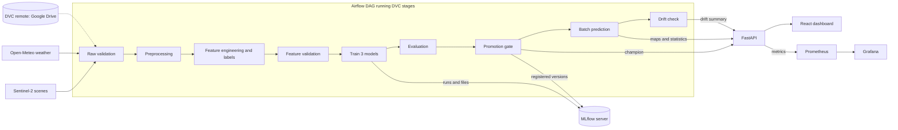
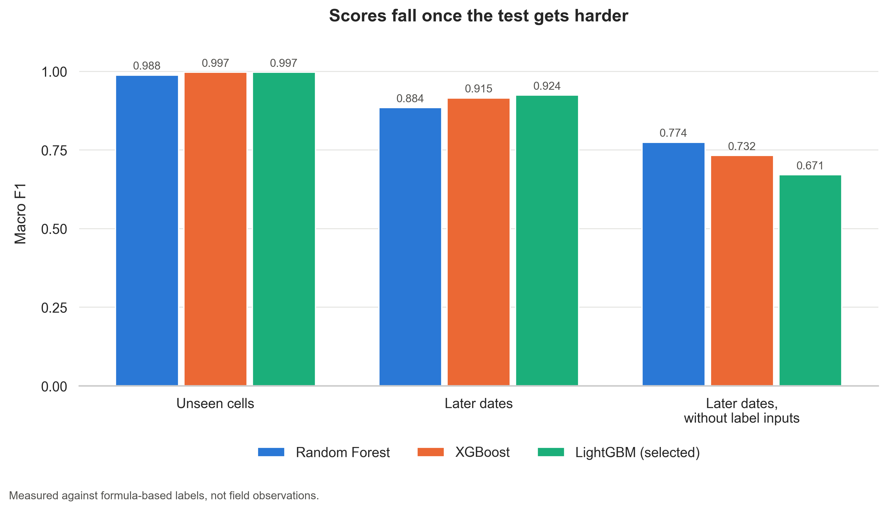

# AgroScope

AgroScope estimates crop water stress on the Nira Left Bank Canal in Maharashtra from satellite and weather data, and turns it into irrigation advice in English, Marathi and Hindi. It's an MLOps course project covering versioned data, tracked experiments, a release gate, orchestration, monitoring and CI.

**Status:** a working demonstration on one past season, October 2023 to March 2024. It isn't validated against field measurements, so don't use it for real water decisions. See [Limitations](#limitations).

## Architecture



| Component | Tool | Where |
| :--- | :--- | :--- |
| Data and pipeline versioning | DVC, with Google Drive as the remote | `dvc.yaml`, `dvc.lock` |
| Orchestration | Airflow | `airflow/dags/agroscope_pipeline.py` |
| Data validation | Custom checks that stop the run on failure | `src/validation/validate_data.py` |
| Models | Random Forest baseline, with XGBoost and LightGBM candidates | `src/training/train.py` |
| Experiments and registry | MLflow server | `src/training/tracking.py` |
| Release gate | Minimum score, and at least match the champion | `src/training/promote.py` |
| Explanations | SHAP | `src/inference/explainability.py` |
| Serving | FastAPI in Docker | `api/`, `Dockerfile` |
| Dashboard | React, Vite and Leaflet | `frontend/` |
| Live monitoring | Prometheus and Grafana | `monitoring/` |
| Drift | Evidently | `src/monitoring/drift.py` |
| CI | GitHub Actions: tests, quality check, image build, frontend build | `.github/workflows/ci.yml` |

## One-command setup

You need Docker Desktop with at least 8 GB of memory. The API image includes the model, results and a frontend build, so those files must exist before the first build.

**1. Get the files.** With access to the DVC remote and with Python 3.10 and Node.js 20 installed:

```bash
python -m venv .venv
```
```bash
.venv/Scripts/pip install -r requirements-dev.txt
```
```bash
.venv/Scripts/dvc pull
```
```bash
npm ci --prefix frontend
```
```bash
npm run build --prefix frontend
```

**Without access to the remote**, create synthetic placeholder results instead. The system runs, but the results mean nothing, and Airflow can't run the full pipeline without the real data:

```bash
.venv/Scripts/python scripts/make_placeholder_artifacts.py
```

**2. Start everything:**

```bash
docker compose up --build
```

| Service | Address | Sign-in |
| :--- | :--- | :--- |
| Dashboard | http://localhost:8000/dashboard/ | None |
| API docs | http://localhost:8000/docs | None |
| MLflow | http://localhost:5000 | None |
| Airflow | http://localhost:8080 | `admin` / `admin`, local demo only |
| Grafana | http://localhost:3000 | None to view |
| Prometheus | http://localhost:9090 | None |

**3. Run the pipeline.** In Airflow, start the `agroscope_pipeline` DAG. MLflow's data lives in a Docker volume, so a new machine starts with an empty registry until this runs. Then load the new results:

```bash
docker compose restart api
```

`docker compose down -v` deletes MLflow's runs and registry, so leave off `-v` unless you mean to.

## Results

Macro F1 from the latest run. **These are measured against labels calculated by a formula, not field observations.**

| Model | Role | Unseen cells | Later dates | Later dates without label inputs |
| :--- | :--- | :--- | :--- | :--- |
| Random Forest | Baseline | 0.9877 | 0.8845 | 0.774 |
| XGBoost | Candidate | 0.9967 | 0.915 | 0.7323 |
| **LightGBM** | **Champion** | 0.9966 | **0.9242** | 0.6707 |



| Measure | Result |
| :--- | :--- |
| p95 latency | 150.5 ms |
| Throughput | 170.79 requests per second |
| Error rate | 0% of 10,257 requests |
| Inputs drifted on the published date | 100% |
| Simulated drift, unchanged control | 0% |
| Simulated drift, after shifting 9 inputs | 36%, with all 9 flagged and no others |
| Largest macro F1 gap between canal reaches | 0.0124 |

Screenshots of each tool are in [docs/screenshots](docs/screenshots). Full details are in the [performance report](reports/performance_report.md), the [model card](docs/MODEL_CARD.md), the [data card](docs/DATA_CARD.md) and the [responsible AI statement](docs/RESPONSIBLE_AI.md).

## Limitations

- **Circular labels:** labels are calculated from three of the model's own inputs. Without those inputs, the later-dates score drops from 0.9242 to 0.6707, and the selected model is the weakest of the three on that test.
- **No field validation:** nothing has been checked against field measurements, and no agronomist has reviewed the thresholds or advice.
- **One season:** the data covers one Rabi season, so monsoon and other years are untested.
- **Scores fall through the season:** macro F1 goes from 0.9919 on 2024-02-03 to 0.7633 on the published date.
- **Little separation late in the season:** 97.2% of the vegetated area is HIGH on the published date. Earlier dates vary more.
- **Past-date maps aren't a test:** the model trained on 75% of cells across these dates.
- **Approximate area:** the project author marked the canal boundary by hand, and the reported 120,625 ha is larger than the 66,250 ha culturable area on record.
- **Coarse and crop-blind:** each cell covers 6.25 ha, and all crops use one coefficient.
- **Run by hand:** a person starts the pipeline, and no timer or live data feed exists.
- **Translations:** no native speaker has reviewed the Marathi and Hindi interface text.

These stay out of scope until after submission: crop type classification, Sentinel-1 radar, advice for individual fields, a database, scheduled live data and public deployment.

## AWS extension: not built

**The AWS extension hasn't been built, and this was a deliberate decision.** The course rubric lists it, so this is a known gap in the submission. The project keeps to free tiers, and the time went to the rubric's other required parts. Everything runs locally in Docker Compose.

The design already separates the parts that would move:

| Local today | On AWS |
| :--- | :--- |
| Local Docker images | Amazon ECR |
| API in Docker Compose | ECS Fargate or EC2, behind a load balancer |
| Google Drive DVC remote | S3 |
| MLflow in a Docker volume | MLflow on ECS or EC2, with RDS for its database and S3 for its files |
| Airflow as one container | Amazon MWAA, or Airflow on EC2 |
| Prometheus and Grafana | CloudWatch, or the same tools on ECS |
| GitHub Actions, build only | GitHub Actions pushing to ECR and deploying |
| `.env` file | AWS Secrets Manager |

The code changes would be small, because storage and service addresses are already settings. The main costs are ongoing charges and adding proper sign-in and network rules.

## Common commands

Run these from the project root.

| Task | Command |
| :--- | :--- |
| Run tests | `.venv/Scripts/pytest tests -v` |
| Show the pipeline | `.venv/Scripts/dvc dag` |
| Rerun the pipeline locally, with Compose running | `.venv/Scripts/dvc repro` |
| Run the frontend in development | `npm run dev --prefix frontend` |
| Load test | `.venv/Scripts/python scripts/load_test.py` |
| Simulate drift | `.venv/Scripts/python scripts/simulate_drift.py` |
| Scores by date and canal reach | `.venv/Scripts/python scripts/holdout_scores.py` |
| Rebuild the performance report | `.venv/Scripts/python scripts/build_performance_report.py` |

Activate the environment before `dvc repro`, because stages run with `python`.

Satellite scenes aren't a pipeline stage, because a rerun could trigger a very large download. They're versioned with `data/raw/satellite.dvc`.

## Data credits

Contains modified Copernicus Sentinel data 2023-2024, accessed through Microsoft Planetary Computer. Weather from [Open-Meteo](https://open-meteo.com/), under CC BY 4.0. Maps © OpenStreetMap contributors, © CARTO, and EOxCloudless 2025 by EOX IT Services GmbH.

## License

See [LICENSE](LICENSE).
