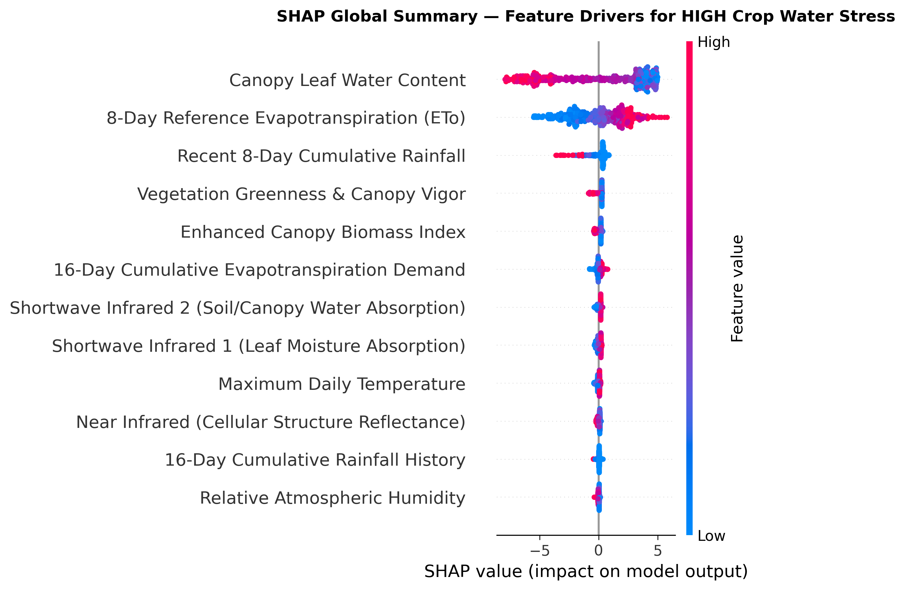

# AgroScope Model Card

**Model:** `agroscope-stress-classifier`, version 1, a LightGBM classifier. It was released through the promotion gate on 2026-11-04.

## Purpose

The model sorts each 250 m cell of the Nira Left Bank Canal area into LOW, MODERATE or HIGH crop water stress, for one satellite date. Those classes feed rule-based irrigation advice in English, Marathi and Hindi.

**It supports decisions and doesn't make them.** It hasn't been checked against any field measurement.

## Data

| Item | Detail |
| :--- | :--- |
| Rows | 566,319 cell-dates, of which 539,852 are vegetated and used for training |
| Dates | 27, from 2023-10-06 to 2024-03-29, in one Rabi season |
| Inputs | 25: 12 satellite values and 13 weather values |
| Labels | Calculated by a water-deficit formula, not observed |

Full details are in the [data card](DATA_CARD.md).

## Models compared

All three use the same data and fixed settings, with no hyperparameter tuning. Scores are macro F1.

| Model | Role | Unseen cells | Later dates | Later dates without label inputs |
| :--- | :--- | :--- | :--- | :--- |
| Random Forest | Baseline | 0.9877 | 0.8845 | 0.774 |
| XGBoost | Candidate | 0.9967 | 0.915 | 0.7323 |
| **LightGBM** | **Candidate, selected** | 0.9966 | **0.9242** | 0.6707 |

- **Unseen cells:** 25% of cells held out, covering the same dates as training.
- **Later dates:** trained before 2024-02-01 and tested from that date on. This score selects the model and is used by the gate.
- **Later dates without label inputs:** the same test with the three inputs the labels are calculated from removed.

## The leakage finding

**The high scores don't show real-world skill.** The labels are calculated from `ndwi_mean`, `rainfall_8day` and `et0_8day_sum`, and the model takes those same three values as inputs. So the scores mostly show how well a model has relearned the formula.

Removing those inputs drops the later-dates score from 0.9242 to 0.6707. That lower figure is the better guide, though it still measures agreement with a formula.

**The selected model relies on this most.** LightGBM wins on later dates but is the weakest of the three once the label inputs are removed, where Random Forest leads. The selection rule was agreed before these results, and it was kept rather than changed after seeing them. Replacing the labels is the real fix, and it's planned for after submission.

## Performance over time

Scores fall through the season, as conditions move further from the training period. These come from a model trained only on dates before 2024-02-01, in `reports/holdout_scores.json`.

| Date | Macro F1 | Classes present |
| :--- | :--- | :--- |
| 2024-02-03 | 0.9919 | 3 |
| 2024-02-23 | 0.8859 | 3 |
| 2024-03-04 | 0.8063 | 3 |
| 2024-03-24, the published date | 0.7633 | 2 |

**On the date the dashboard publishes, the score is below the 0.85 minimum used for the whole later period.** The minimum applies to that overall score, so this date alone doesn't trigger the gate.

## Performance by area

The data has no demographic variables, so results are compared along the canal, from the headworks in the west to the tail in the east. These are from the same model and test, and `scripts/holdout_scores.py` recreates them.

| Reach | Longitude | Rows | Macro F1 | Accuracy | HIGH recall |
| :--- | :--- | :--- | :--- | :--- | :--- |
| Head | 74.054 to 74.374 | 51,173 | 0.9145 | 0.9864 | 0.99 |
| Middle | 74.375 to 74.693 | 95,596 | 0.9239 | 0.9788 | 0.9827 |
| Tail | 74.695 to 75.014 | 84,357 | 0.9269 | 0.9736 | 0.9765 |

The largest macro F1 gap is 0.0124, so the model agrees with the formula about equally well along the canal. It doesn't show that the formula itself is equally right everywhere, or that water reaches the tail as it reaches the head.

## Explaining a prediction

SHAP works with this model, and `/predict` returns the top four inputs behind each answer. This real example is cell `NLBC_CELL_0008` on 2024-03-24, predicted HIGH with 0.9999 confidence, from `reports/shap_example.json`.

| Input | Value | Share of the explanation |
| :--- | :--- | :--- |
| `et0_8day_sum` | 57.69 mm | 63.1% |
| `et0_16day_sum` | 113.35 mm | 7.5% |
| `rainfall_8day` | 0.0 mm | 7.3% |
| `ndvi_mean` | 0.334 | 4.2% |

The answer rests mainly on evaporative demand with no rain, which matches how the label formula works.

Confidence near 1.0 reflects certainty about the formula, not about the crop. The word `increases_stress` in the output means pushing toward the predicted class, which is misleading when that class is LOW. Stored map results don't include SHAP values yet.

## Limits

- **Past dates aren't a test:** the dashboard can show all 27 dates, but the model trained on 75% of cells across those dates, so most of each map repeats its training data. Use the later-dates scores above to judge the model, not these maps.
- **One season:** the data covers one Rabi season, so monsoon and other years are untested.
- **Little separation:** 97.2% of the vegetated area is HIGH on the published date, so it can't yet rank areas for water.
- **Crop and soil are ignored:** every cell uses one crop coefficient of 0.95.
- **Coarse cells:** at 6.25 ha, a cell covers several farms.
- **Unreviewed thresholds:** stress thresholds were set before a reflectance fix, and no expert has reviewed them.
- **Simulator:** `/predict` fills inputs it isn't given with fixed values, so it's a what-if tool only.

## Release and monitoring

A candidate is released only if its later-dates score reaches 0.85 and at least matches the champion. Each registered version records its model type, score, data hash and gate decision in MLflow.

Evidently compares the published date with the training period, and Prometheus and Grafana show the result live. See the [performance report](../reports/performance_report.md).
